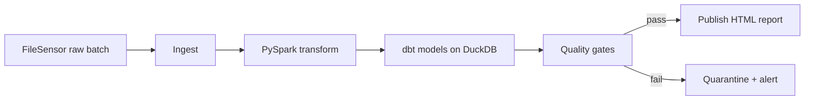

# Airflow ELT with Data Quality Gates

I built this as a small, honest portfolio piece. It is one Airflow DAG that runs a daily trade-data ELT end to end: land a batch, transform it with PySpark in local mode, build simple models with dbt-style SQL on DuckDB, then run hard data quality gates. If the gates pass, an HTML report is published. If they fail, the batch is quarantined, an alert is written, and publish is blocked.

There are no external APIs and no downloads. Data is seeded synthetic trades. One day (`2024-06-03`) is deliberately bad so the gate is easy to demo.

Live report: https://rahul9121.github.io/airflow-elt-data-quality/

## What it shows

- TaskFlow API DAG with retries, execution timeout, and a failure callback
- FileSensor waiting on a `_SUCCESS` marker for the raw batch
- Branching on gate results (`publish_report` vs `quarantine_and_alert`)
- Catchup / backfill across five dates
- Checks for schema drift, null rates, value ranges, referential integrity, row counts, and raw-vs-processed reconciliation
- pytest DAG integrity tests and unit tests for the checks
- GitHub Actions that lint, test, build the Docker image, run a good day and a blocked bad day, and publish the report to GitHub Pages

## Flow



## Run in three commands

```bash
python -m venv .venv
# Windows: .venv\Scripts\activate
source .venv/bin/activate
pip install -r requirements-ci.txt
make backfill
```

That seeds five days, runs the pipeline for each day (the bad day exits blocked), and writes `reports/index.html`.

### Docker (full Airflow UI)

```bash
make up
# UI at http://localhost:8080  admin / admin
```

### Lighter fallback (low memory)

```bash
pip install -r requirements.txt
make standalone
```

## Real results from this repo

| Date       | Outcome | Notes |
|------------|---------|-------|
| 2024-06-01 | pass    | ~180 trades |
| 2024-06-02 | pass    | clean batch |
| 2024-06-03 | blocked | schema drift, nulls, bad sides/qty, orphan accounts |
| 2024-06-04 | pass    | clean batch |
| 2024-06-05 | pass    | clean batch |

On the bad day the gate fails several checks at once. The batch is copied under `data/quarantine/` and an alert JSON is written under `data/alerts/`. The report page shows the fail badges and the quarantine record.

## Project layout

- `dags/trade_elt_quality_dag.py` – TaskFlow DAG
- `checks/quality_gates.py` – gate implementations
- `scripts/seed_data.py` – synthetic batches
- `scripts/run_pipeline.py` – headless runner used by Make and CI
- `scripts/generate_report.py` – static HTML report
- `dbt_project/` – model SQL and DuckDB profile
- `tests/` – DAG integrity + gate unit tests
- `Dockerfile`, `docker-compose.yml`, `Makefile`

## Limitations

- PySpark runs in local mode on tiny data. This is for demonstration, not a cluster workload.
- dbt models are kept simple and the DAG materializes them through DuckDB Python so CI stays reliable without a full dbt network install dance.
- Alerts are JSON files, not PagerDuty or email.
- The Airflow FileSensor needs the seeded `_SUCCESS` marker; there is no remote object store.
- GitHub Actions uses `airflow dags test` plus the headless runner. That is enough to prove parse and task logic, not a long-running multi-worker deployment.

## License

MIT
